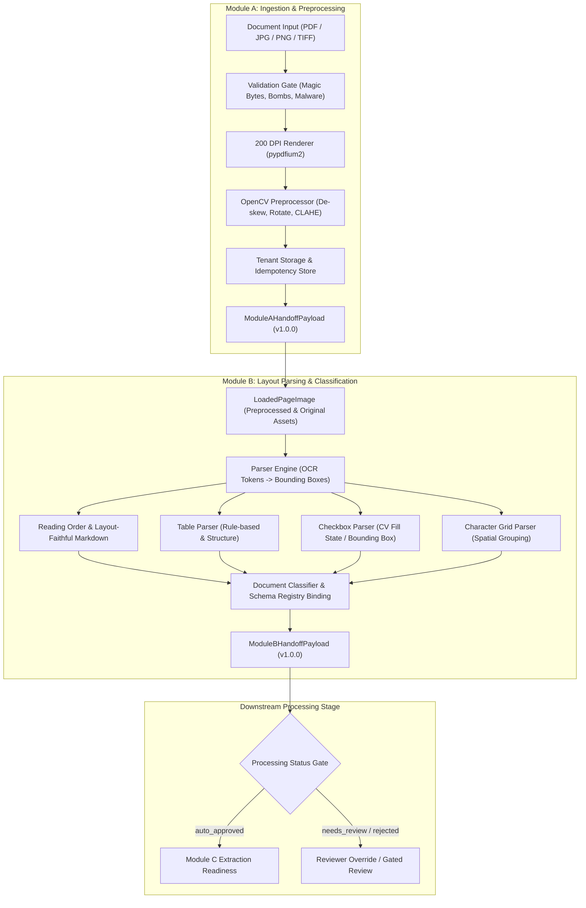

# Document Extraction Engine

## Overview

The **Document Extraction Engine** is an on-premise, schema-driven system designed to transform scanned BFSI (banking, financial services, insurance) and healthcare documents into validated, evidence-grounded structured data.

The system is architected as a modular, decoupled processing pipeline. The authoritative specification is **PRD v1.3** ([`Document_Extraction_Engine_PRD.md`](Document_Extraction_Engine_PRD.md): 1-stage multimodal extraction with `Qwen3-VL-8B-Instruct` / `Qwen2.5-VL-7B-Instruct`). See "Repository documents" below for the other PRD copies in this repository.
1. **Module A — Document Ingestion & Preprocessing**: Safe reception, multi-format validation, 200 DPI rendering, image de-skewing, normalization, and secure tenant storage.
2. **Module B — Layout Parsing & Document Classification**: Visual layout structure parsing (blocks, reading order, Markdown formatting), structural element extraction (tables, checkboxes, character grids), deterministic document classification, and schema binding.
3. **Module C — Extraction & Grounding**: `ModuleCPipeline` is the single extraction orchestrator. It reads every page image with the multimodal extractor (or the OCR/text extractor), aggregates pages, grounds each value in page-specific evidence, validates, and gates the output status. A real Qwen-VL run on a GPU has **not** been verified yet (the test suite uses a faked model call); VLM-read fields carry no confidence, so those documents always route to `needs_review`.

---

## Architecture & Workflow

The verified processing pipeline coordinates data transfer across strict boundary envelopes and coordinate spaces:



---

## Implemented Module Capabilities

### 1. Module A: Document Ingestion & Preprocessing

Module A acts as Stage 1 of the engine, accepting raw incoming document files and producing clean, standardized, 200-DPI page artifacts with invertible transformation histories:

- **Multi-Format Ingestion (`FR-ING-001`)**: Accepts PDF, JPG, PNG, and TIFF formats via structured ingestion interfaces.
- **Strict Input Validation & Security (`FR-ING-002`, `GR-001`)**:
  - Binary magic-byte sniffing (`%PDF-`, `\xFF\xD8\xFF`, `\x89PNG\r\n\x1a\n`, `II*\x00` / `MM\x00*`) to reject spoofed extensions (`UNSUPPORTED_FILE`).
  - Page count boundaries and dimension limits protecting against decompression bombs (`GR-001`).
- **Pluggable Malware Boundary (`FR-ING-003`, `SEC-009`)**:
  - `MalwareScanner` boundary interface with fail-closed behavior (`SCANNER_UNAVAILABLE`).
  - Rejection with audit status `rejected_malware` on signature detection (e.g. EICAR).
- **Standardized 200 DPI PDF Rendering (`FR-ING-004`, `SCH-013`)**:
  - `pypdfium2` rendering engine scaled strictly at $200 / 72.0 \approx 2.7778$ to produce uniform 200-DPI images.
  - Multi-page splitting with 1-based page ordering, dimension tracking, and parent `document_id` linkage.
- **OpenCV Image Cleaning & Preprocessing (`FR-ING-005`)**:
  - De-skewing via Probabilistic Hough Line Transform (`HoughLinesP`).
  - Orientation analysis using text projection profile variance.
  - Contrast normalization via Contrast Limited Adaptive Histogram Equalization (CLAHE).
  - Transformation metadata persistence (angle, residual skew, scale, padding) enabling full inversion.
- **Coordinate Transformation Inversion (`SCH-013`)**:
  - `CoordinateTransform.map_bbox_preprocessed_to_original()` accurately projects downstream 200-DPI preprocessed bounding boxes back to original un-skewed page coordinates.
- **Tenant-Isolated Storage & Replay Protection (`FR-ING-006`, `SEC-005`, `API-013`)**:
  - Storage segregated strictly by `{storage_base_dir}/{tenant_id}/{document_id}/` with traversal guards.
  - 24-hour replay protection using `Idempotency-Key` and streaming SHA-256 content hashing with per-key concurrency locking (`NFR-006`).
- **Structured Handoff Envelope (`ARC-003`, `SCH-011`)**:
  - Produces immutable, serializable `ModuleAHandoffPayload` (v1.0.0) recording document metadata, page counts, hashes, and relative storage URIs.

---

### 2. Module B: Visual Layout Parsing & Document Classification

Module B acts as Stage 2 of the engine, consuming `ModuleAHandoffPayload` and transforming raw pixels into structured visual layout blocks, specialized form components, and validated document classifications:

- **Pluggable Parser Engine Architecture (`ARC-002`, `FR-PRS-001`)**:
  - `ParserEngine` interface with `LocalOCRParserAdapter` accepting raw OCR tokens.
  - Preserves optical confidence scores ($[0.0, 1.0]$) alongside bounding boxes and text content (`FR-PRS-005`).
- **Visual Layout & Reading-Order Formatting (`FR-PRS-001`)**:
  - Token sorting and block aggregation preserving logical reading order (top-to-bottom, left-to-right).
  - Emits layout-faithful page Markdown representations for LLM consumption.
- **Structured Table Extraction (`FR-PRS-002`)**:
  - Detection of tabular regions, header rows, data cells, row spans, and column spans.
  - Emits normalized cell coordinates and confidence metrics.
- **Checkbox Detection & Interpretation (`FR-PRS-003`)**:
  - Form field checkbox parsing calculating fill states (`checked`, `unchecked`, `indeterminate`) using contour pixel-density thresholds.
  - Links visual bounding boxes with adjacent label tokens.
- **Character Grid Extraction (`FR-PRS-004`)**:
  - Detects segmented character boxes common in Indian identity documents, PAN applications, and bank account forms.
  - Spatial grouping of adjacent individual letter cells into unified field tokens.
- **Document Classification & Schema Binding (`FR-CLS-001` - `FR-CLS-004`)**:
  - Deterministic classification engine evaluating keyword distributions, visual layouts, and form signatures across standard banking documents (e.g. DOC-01 Bank Account Opening Form, DOC-02 KYC, DOC-03 Cheque).
  - Schema registry binding matching classified documents to validated target extraction schemas.
  - Threshold-gated decision rules: classifications above threshold are marked `auto_approved`; low confidence or ambiguous matches route to `needs_review`.
- **Pipeline Orchestration & Lifecycle Status Gates (`SCH-012`)**:
  - Unified pipeline coordinator (`ModuleBPipeline`) executing:
    $$\text{Payload Handoff} \longrightarrow \text{Image Loading} \longrightarrow \text{Layout Parsing} \longrightarrow \text{Classification} \longrightarrow \text{Status Gating}$$
  - Enforces processing state transitions (`processing`, `auto_approved`, `needs_review`, `rejected`, `failed`).
  - Supports explicit reviewer overrides to amend classification or schema assignment during manual validation.
- **Structured Module B Handoff Payload (`SCH-011`)**:
  - Emits versioned `ModuleBHandoffPayload` containing complete page layout structures, tables, checkboxes, character grids, classification metadata, and markdown text.

---

## Security & Deployment Boundaries

1. **Egress Isolation (`ARC-001`, `SEC-011`)**:
   - Application configuration (`Settings`) enforces `allow_external_egress=False` and fails closed on startup if external network egress is enabled.
   - *Deployment Requirement*: Container/infrastructure firewalls must enforce total egress blocking.
2. **Tenant Isolation & Path Traversal Guards (`SEC-005`, `SEC-006`)**:
   - Filesystem operations strictly contained within `{storage_base_dir}/{tenant_id}/{document_id}/`.
   - Any path traversal sequence (`..`, `/`, `\`) is rejected immediately.
3. **Malware Defense (`SEC-009`)**:
   - Clean boundary separation ensures un-scanned or infected payloads cannot advance to rendering or layout parsing.
4. **Idempotency & Concurrency Safety (`API-013`, `NFR-006`)**:
   - Replay protection with streaming SHA-256 hashing and per-key threading locks prevents duplicate creation under identical concurrent requests.

---

### 3. Module C: Field Extraction, Validation & Canonical Envelope

Module C acts as Stage 3 of the engine, consuming `ModuleBOutputPayload` and transforming layout blocks, tables, character grids, and checkboxes into validated, evidence-grounded canonical JSON:

- **Schema-Constrained Extraction (`FR-EXT-001`, `FR-EXT-002`)**:
  - Implements `SchemaGuidedExtractor` supporting local LLM grammar decoding (Instructor + LiteLLM) with deterministic heuristic fallback.
  - Supports launch document types: DOC-01 CASA Account Opening, DOC-02 Insurance Application, and DOC-03 Hospital Discharge Summary.
- **Null-if-Absent Logic (`FR-EXT-003`, `GR-003`)**:
  - Strictly returns `value: null` with `null_reason: "absent"` or `"illegible"` for absent or unreadable fields; zero inference/hallucination.
- **Pixel-Space Evidence Grounding (`FR-EXT-004`, `GR-002`, `SCH-013`)**:
  - Links every non-null extracted value to 1-based page, 200-DPI pixel bounding box `(x0, y0, x1, y1)`, and raw source snippet.
  - Ungrounded values are forced to `value: null`, `null_reason: "absent"`, `review_required: true`, and flagged with `EVIDENCE_MISSING`.
- **Repeating Groups & Arrays (`FR-EXT-005`)**:
  - Extracts repeating groups maintaining sequential page order (nominees in DOC-02, medications in DOC-03).
- **Checkbox Mapping (`FR-EXT-007`)**:
  - Normalizes visual checkbox marks `[x]` to `true`, `[ ]` to `false`, and flags uncertain marks.
- **Field Normalization (`FR-VAL-001`)**:
  - Dates normalized to ISO 8601 (`YYYY-MM-DD`).
  - Phone numbers normalized to E.164 (`+91...`).
  - Currency/amounts parsed to decimal floats with ISO 4217 currency codes.
- **Format Validators (`FR-VAL-002`)**:
  - Indian PAN format validation (`^[A-Z]{5}[0-9]{4}[A-Z]$`).
  - Indian Aadhaar 12-digit format and Verhoeff checksum algorithm validation.
  - Indian IFSC code format validation (`^[A-Z]{4}0[A-Z0-9]{6}$`).
- **Business Logic & Cross-Field Rules (`FR-VAL-003`, `FR-VAL-004`)**:
  - Arithmetic reconciliation of itemized amounts vs declared total (`ARITHMETIC_MISMATCH`).
  - Chronology validation ensuring discharge date $\ge$ admission date (`CHRONOLOGY_MISMATCH`).
- **Confidence & Status Gating (`FR-CNF-001` - `FR-CNF-003`, `GR-027`)**:
  - Field confidence comes only from measured signals (the evidence's optical OCR confidence and, when an extractor supplies one, a model score). When no trustworthy signal exists the confidence is `null` (`None`) with provenance `unavailable`; nothing is invented. The Qwen-VL extractor currently supplies no confidence, so VLM-read fields are always `null` and the document routes to `needs_review` (a deliberately conservative policy).
  - Threshold gating: scores $< 0.75$, unavailable/uncalibrated scores or validation failures trigger `review_required: true`.
  - Document status gating: documents auto-approve only when all fields pass with no flags (missing required fields, conflicts, partial page coverage, evidence missing, rule failures all force `needs_review`), otherwise routing to `needs_review`.
  - A reviewer's document-type override (FR-CLS-004) is recorded as `confidence_provenance: "human_override"`, a human decision rather than a model or rule score.
- **Canonical JSON Output Envelope (`SCH-011` - `SCH-013`)**:
  - Versioned `CanonicalExtractionEnvelope` adhering strictly to PRD §6.3.

---

## Project Setup & Local Development

### 1. Prerequisites
- **Python**: `requires-python >=3.10`. **Verified in this repository** (full test suite, clean install): macOS with Python **3.11.15** and **3.14**. Python 3.10, 3.12 and 3.13 are declared-compatible but **have not been verified**; Python 3.9 and older are rejected by `pip`.
- **Operating System**: Linux, macOS, or Windows. Verification above was done on macOS only.
- **Tesseract OCR binary (external, required by the default OCR backend)**: the `pytesseract` Python package is only a wrapper and is installed automatically, but the `tesseract` executable itself must be installed separately:
  - macOS: `brew install tesseract`
  - Debian/Ubuntu: `sudo apt-get install tesseract-ocr`
  - Windows: install the UB-Mannheim Tesseract build and add it to `PATH` (or set `ocr_tesseract_cmd`).
  - Extra languages need their tessdata packs (e.g. `tesseract-ocr-hin`). Verify with `tesseract --version` and `tesseract --list-langs`.
  - Without it the default backend fails closed with `OCR_BINARY_MISSING` (it never produces empty pages).

### 2. Environment Installation

```bash
# Create and activate virtual environment
python -m venv .venv

# On Linux/macOS:
source .venv/bin/activate

# On Windows (PowerShell):
.venv\Scripts\Activate.ps1
```

Install exactly the components you need (the extras are mirrored by the `requirements-*.txt` files):

| Goal | Command | Installs |
| --- | --- | --- |
| Engine (core) | `pip install -e .` | Modules A/B/C, schema lifecycle, Tesseract wrapper, `instructor`/`litellm` |
| Development / run the tests | `pip install -e ".[dev]"` | core + pytest, pytest-cov |
| Demo UI (`doc_extractor.app`) | `pip install -e ".[ui]"` | core + gradio |
| Local multimodal Qwen3-VL | install PyTorch + torchvision first (below), then `pip install -e ".[vlm]"` | core + transformers (>=4.57.1), accelerate (>=0.26.0), bitsandbytes (>=0.43.1), qwen-vl-utils (==0.0.14) |

Extras combine, e.g. `pip install -e ".[dev,ui]"`. Without an editable install, use `pip install -r requirements.txt` (core), `requirements-dev.txt`, `requirements-ui.txt` or `requirements-vlm.txt`.

**PyTorch and torchvision are not installed by any command above.** They are platform-specific, so install the builds for your machine *before* the `vlm` extra (see <https://pytorch.org/get-started/locally/>), for example `pip install torch torchvision --index-url https://download.pytorch.org/whl/cu126` (CUDA 12.x). `qwen-vl-utils` imports `torchvision`, so the two must match. On Kaggle and Colab keep the preinstalled torch/torchvision: do not upgrade or reinstall them. The full GPU runtime guide is in "Qwen3-VL GPU runtime" below.

### 3. Configuration

The application does **not** read a `.env` file or environment variables. [`.env.example`](.env.example) is a reference of the available settings: each key is the upper-case name of a field on `doc_extractor.config.Settings`. Provide values in code:

```python
from doc_extractor.config import Settings, load_settings

settings = Settings(ocr_backend="tesseract", ocr_tesseract_lang="eng")
settings = load_settings({"app_env": "staging", "max_page_count": 50})   # validated
```

and pass them on (for example `ModuleBPipeline(storage, settings=settings)` or `doc_extractor.app.configure_settings(settings)`). Copying `.env.example` to `.env` has no effect. The default LLM setting is the Ollama text model; the multimodal Qwen-VL extractor (`Qwen/Qwen3-VL-8B-Instruct`) is selected on `SchemaGuidedExtractor`, not through `llm_model_name`.

#### Module B OCR backend

Module B builds its parser from `Settings.ocr_backend` (fields can be passed as `Settings(...)` / `load_settings({...})`; `ModuleBPipeline(storage, settings=...)` uses them when no `parser=` is injected):

| `ocr_backend` | Parser | Notes |
| --- | --- | --- |
| `tesseract` (default) | Local Tesseract OCR on every page image | Needs `pytesseract` + the Tesseract binary |
| `pdfium_hybrid` | Native PDF text per page, Tesseract fallback | Fallback also needs Tesseract |
| `pdfium` | Native PDF text only | No OCR: fails on scanned pages and images |
| `none` | Explicit no-parser mode | Reported non-operational; Module B fails closed with `PARSER_NOT_CONFIGURED` |

Related settings: `ocr_tesseract_lang` (default `eng`, e.g. `eng+hin`), `ocr_tesseract_config` (e.g. `--psm 6`), `ocr_tesseract_cmd` (explicit executable path). A missing package, executable, language pack or invalid value fails immediately with an actionable error (`OCR_DEPENDENCY_MISSING`, `OCR_BINARY_MISSING`, `OCR_BINARY_UNUSABLE`, `OCR_LANGUAGE_MISSING`) instead of silently producing empty pages. A parser without an OCR extractor never reports itself as operational.

---

## Qwen3-VL GPU runtime

The 1-stage multimodal path (PRD v1.3) runs `Qwen/Qwen3-VL-8B-Instruct` locally through Transformers. All loading logic lives in `doc_extractor/vlm_runtime.py`; `SchemaGuidedExtractor` uses it. **Status: implemented and unit-tested with fakes; it has not yet been executed on a GPU.**

| Item | Value |
| --- | --- |
| Primary checkpoint | `Qwen/Qwen3-VL-8B-Instruct` (the default). `Qwen/Qwen2.5-VL-7B-Instruct` (PRD alternate) is supported with its own class and 14-px patches; any other checkpoint is rejected with `VLM_UNSUPPORTED_MODEL` |
| Transformers class | `Qwen3VLForConditionalGeneration` (explicit; there is no fallback to `AutoModelForCausalLM` / `AutoModel`) |
| Transformers version | **>= 4.57.1.** Qwen3-VL first ships in 4.57.0 (itself yanked); 4.56.x has no Qwen3-VL. Checked by inspecting the 4.57.1 release (class present; accelerate/bitsandbytes floors), **not yet by a GPU run** |
| Other pins | `qwen-vl-utils==0.0.14` (reproducible baseline), `accelerate>=0.26.0`, `bitsandbytes>=0.43.1` (the floors Transformers enforces for 4-bit) |
| Recorded per run | Exact `transformers` / `torch` / `torchvision` / `qwen-vl-utils` / `accelerate` / `bitsandbytes` versions, loader class, dtype, quantization, GPU(s) and image settings, in the envelope's `run.provenance.details["runtime"]` |

**Installation (GPU host):**

```bash
pip install torch torchvision --index-url https://download.pytorch.org/whl/cu126   # skip on Kaggle/Colab
pip install -e ".[vlm]"        # transformers, accelerate, bitsandbytes, qwen-vl-utils==0.0.14
```

**GPU requirements.** An NVIDIA GPU with CUDA is required (4-bit quantization needs it; there is no CPU default). Total VRAM must be at least ~6 GiB with 4-bit (default) or ~16 GiB unquantized (PRD NFR-007); the loader checks this before loading and says what to change. These are weights-only pre-flight minimums: activations and the KV cache for a full 200-DPI page need more.

**Precision selection** (`precision="auto"` by default; no silent changes):

| GPU | Compute capability | `auto` picks | Explicit `bfloat16` |
| --- | --- | --- | --- |
| A100, A10, L4, RTX 30xx/40xx | >= 8.0 | `bfloat16` | honoured |
| **Tesla T4**, V100, P100 | < 8.0 | `float16` | **rejected** (`VLM_DTYPE_UNSUPPORTED`) |
| No GPU | n/a | error `VLM_GPU_REQUIRED` unless `allow_cpu=True` (then `float32`, very slow) | n/a |

BF16 is chosen from the compute capability, not from `torch.cuda.is_bf16_supported()` (recent PyTorch returns True on older GPUs by emulation). An explicit `precision="float16"` / `"float32"` is always honoured.

**4-bit quantization** (`load_in_4bit=True`, the default): bitsandbytes NF4 with double quantization; the compute dtype is the *selected* dtype (FP16 on a T4), and the non-quantized layers are loaded in the same dtype. If CUDA, `bitsandbytes>=0.43.1` or `accelerate>=0.26.0` is missing the load fails with `VLM_QUANTIZATION_UNAVAILABLE`; it never falls back to another precision. Set `load_in_4bit=False` only on a GPU with enough memory.

**Image processing.** `qwen-vl-utils` resizes each page image once (aspect ratio kept, each side rounded to a multiple of 32 = 16-px patches x 2 merge), then the processor is called with `do_resize=False`, so there is no second resize. `process_vision_info` is always called with `image_patch_size=16` (its default of 14 is Qwen2.5-VL's). `min_pixels` / `max_pixels` default to the checkpoint's official range (65,536 / 16,777,216 px), so a full 200-DPI A4 page (about 3.9 MP, roughly 3.8k visual tokens) is not down-scaled. Lowering `max_pixels` to save memory is allowed but explicit, trades reading accuracy for memory, and is recorded in the run info. Boxes are `[ymin, xmin, ymax, xmax]` on the model's relative 0-1000 grid over the image it saw, which stays valid for the Module A preprocessed page and `CoordinateTransform` whatever the resize.

```python
from doc_extractor.extractor import SchemaGuidedExtractor

extractor = SchemaGuidedExtractor(          # defaults shown
    model_name="Qwen/Qwen3-VL-8B-Instruct", use_llm=True, allow_fallback=False,
    precision="auto", load_in_4bit=True, min_pixels=None, max_pixels=None,
)
```


**Known T4 limitations** (expected from the hardware; none measured yet):
- No native BF16, so FP16 is used. FP16 can overflow in some models; if outputs are garbage or NaN, report it (the code will not switch precision on its own).
- About 15 GiB per GPU: 4-bit is required for the 8B model (an unquantized load is refused by the VRAM pre-flight). Kaggle's 2xT4 shards the model with `device_map="auto"`.
- No FlashAttention-2 (needs Ampere or newer); attention uses the default SDPA path, so long, high-resolution pages are slow and memory-hungry. Pages are processed sequentially, so latency grows linearly with page count.
- 4-bit bitsandbytes inference is slower than FP16 and carries a small accuracy cost versus unquantized weights; neither effect has been measured for this task.

---

## Testing & Verification Status

### Automated Test Suite
The repository includes unit, regression, integration and end-to-end test coverage across Modules A, B and C, the schema lifecycle, OCR backends, multipage multimodal extraction (with a faked model call) and the DOC-01/02/03 launch types.

**Result (Phase 1):** 812 tests collected; 811 pass and 1 is an explicit skip (the opt-in live Ollama test, below). The Qwen-VL runtime (`vlm_runtime.py`) is covered with fakes; real Qwen-VL / GPU behaviour is not covered by any automated test.

```bash
pip install -e ".[dev]"      # test dependencies
pytest                       # default run: everything except the opt-in live test (reported as skipped)
pytest -rs                   # same, and print why tests were skipped
pytest --cov=src --cov-branch --cov-report=term-missing   # coverage
```

**Opt-in live Ollama test.** `test_live_qwen_smoke_against_local_ollama` (marker `live_ollama`) calls a real Ollama server with the text model `qwen2.5:7b-instruct`; it does **not** exercise the Qwen-VL multimodal path. It is skipped unless explicitly enabled, and once enabled an unavailable server is a genuine failure (never a skip or pass):

```bash
RUN_OLLAMA_TESTS=1 pytest -m live_ollama                         # http://localhost:11434
RUN_OLLAMA_TESTS=1 OLLAMA_API_BASE=http://host:11434 pytest -m live_ollama
```

Tests that need the external Tesseract binary skip with an explicit reason when it is not on `PATH` (`pytest -rs` lists them); everything else mocks the OCR and model layers.

## Repository documents

| File | Purpose |
| --- | --- |
| `Document_Extraction_Engine_PRD.md` | **Authoritative PRD v1.3** (1-stage multimodal extraction with Qwen3-VL-8B-Instruct / Qwen2.5-VL). Phase 1 is measured against this file. |
| `Document Extraction Engine Product Requirements Document (PRD).pdf` | An earlier PRD revision (header dated Oct 28, 2026; exact revision not verified), kept for reference. |
| `src/doc_extractor/Document_Extraction_Engine_PRD (3).md` | PRD **v1.4** (adds category-based model routing, language dimension and a demo UI). It specifies the `RoutedExtractor` / demo category selectors in the code; it is **not** the Phase 1 acceptance baseline. |
| `src/doc_extractor/notebookb4c0029335.ipynb`, `notebookbdb318963a.ipynb` | Kaggle demo launchers that clone a *remote* branch of a collaborator's fork (`feature/prd-v1.3-qwen3-vl-multimodal`), install dependencies and launch the Gradio demo. They run that remote code, **not** this working tree. They do not install the Tesseract binary. |
| `notebooks/*.ipynb`, `notebooks/doc01_support/` | Earlier Colab notebooks for the standalone DOC-01 CASA reader (`casa_reader.py` / `casa_form.py`); legacy, separate from the `ModuleCPipeline` path. |
| `casa_reader.py`, `casa_form.py`, `insurance_form.py` (`src/doc_extractor/`) | Legacy rule-based form readers. They are not used by the canonical pipeline. `casa_reader.py` additionally imports `rapidocr_onnxruntime`, `torch` and `transformers` lazily; these are intentionally not declared dependencies. |

---

## Current Scope Boundaries & Known Limitations

This project is under active development. The current codebase implements **Module A**, **Module B**, and **Module C**. Known open gaps and architecture prerequisites include:

- **Module B OCR Runtime**: Module B now selects a real local parser from `Settings.ocr_backend` (default Tesseract; see "Module B OCR backend"). Cross-process worker integration with isolated OCR engines (e.g. PaddleOCR) is not implemented, and the Tesseract binary must be installed on the host.
- **Local Model Serving Cluster**: Module C supports pluggable LLM extraction (LiteLLM/Instructor) and deterministic extraction heuristics; production deployment on-premise requires containerized vLLM/Ollama services with GPU acceleration per PRD ARC-004/ARC-005.
- **Durable Message Broker**: Inter-module queues currently provide an in-memory adapter (`LocalMemoryQueueAdapter`); production deployment requires connecting a persistent broker (e.g. RabbitMQ or Redis Streams).
- **Distributed Idempotency & Locking**: Current concurrency locking is process-local; multi-replica horizontal clustering requires a shared distributed cache (e.g. Redis).
- **Antivirus Daemon**: Production environments require configuring a live ClamAV daemon socket rather than the development mock scanner.
- **Encryption at Rest**: Customer-held AES-256 volume encryption must be managed at the storage/cloud provider infrastructure layer per `SEC-005`.
