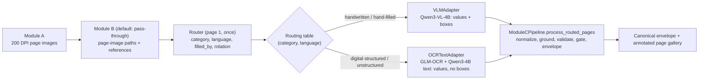
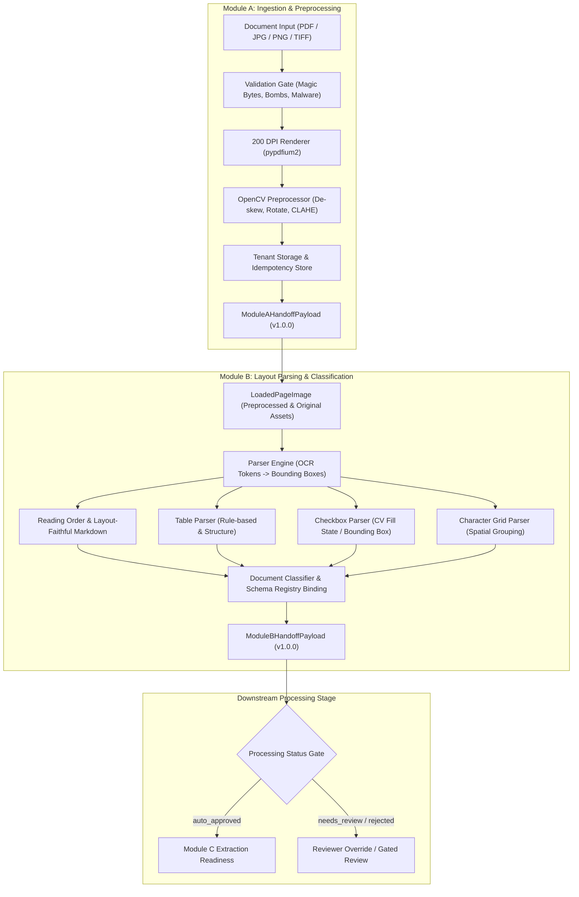

# Document Extraction Engine

## Overview

The **Document Extraction Engine** is an on-premise, schema-driven system designed to transform scanned BFSI (banking, financial services, insurance) and healthcare documents into validated, evidence-grounded structured data.

The system is architected as a modular, decoupled processing pipeline. The authoritative specification is **PRD v1.5** ([`Document_Extraction_Engine_PRD.md`](Document_Extraction_Engine_PRD.md)); earlier revisions are archived under [`docs/prd-versions/`](docs/prd-versions/README.md). Extraction is single-stage and multimodal: a vision-language model (default `Qwen/Qwen3-VL-4B-Instruct`) reads the page image and returns schema JSON with boxes; digital pages can instead be routed to GLM-OCR + a text LLM (PRD D14).
1. **Module A — Document Ingestion & Preprocessing**: Safe reception, multi-format validation, 200 DPI rendering, image de-skewing, normalization, and secure tenant storage.
2. **Module B — Layout Parsing & Document Classification**: Document classification, schema binding and **passing the page-image paths** on. OCR is optional: the default parser is an explicit no-OCR pass-through, and Tesseract / PDFium text are opt-in backends (structural extraction of tables, checkboxes and character grids is available when an OCR backend supplies tokens).
3. **Module C — Extraction & Grounding**: `ModuleCPipeline` is the canonical processing and envelope-assembly layer. The demo app classifies the document once, routes every page to the specialist for its category (`RoutedExtractor` + `VLMAdapter` / `OCRTextAdapter`), and hands the page results to `ModuleCPipeline.process_routed_pages`, which normalizes values, maps boxes to original-page pixels, validates, aggregates pages, grounds each value in page-specific evidence, gates the output status and emits the PRD §6.3 envelope. A real Qwen-VL run on a GPU (Kaggle T4) has **not** been verified yet (the test suite uses a faked model call); VLM-read fields carry no confidence, so those documents always route to `needs_review`.

### PRD v1.5 routed extraction (demo app and `ModuleCPipeline`)



- **Who does what.** The app owns the per-page routing and model calls (so it can stream the live pipeline-steps panel and turn a sideways page upright); `ModuleCPipeline` owns everything after the model call. No page is read twice and no envelope is built outside `pipeline_c.py` (a test enforces this).
- **Routing table** (`routing.DEFAULT_ROUTING_TABLE`, override with a JSON file in `DOC_ROUTING_TABLE`): `structured` and `unstructured` use the OCR + text route, `handwritten` uses the vision model; `alt_engines` (`ocr_text`, `ocr_text_7b`) are the specialists the **Engine** selector can switch to for comparison. A hand-filled page is forced to `handwritten` in code from the router's `filled_by` answer. If the routed specialist fails, the default model runs and the fallback is recorded in the provenance.
- **Evidence rule (PRD GR-002 / FR-EXT-004).** A value without a grounded box is forced to `null` and flagged `EVIDENCE_MISSING`. The OCR + text route has no boxes, so its values are *withheld* (`null`) and flagged; the unverified readings are kept in `run.provenance.details.unverified_readings` as a review aid only, never as field values.
- **Bounding boxes.** One contract everywhere: the model returns `[x1, y1, x2, y2]` (left, top, right, bottom) on a 0-1000 grid relative to the image it saw; Module C maps it with the page's own Module A geometry (`PageImageRef` + `CoordinateTransform`) to `(x0, y0, x1, y1)` pixels of the 200-DPI original page, and the gallery draws exactly those pixels. A page that was turned upright first has its boxes mapped back to the stored page. `PageLayoutOutput.page_image_path` is kept as the Module B path hand-off; the explicit `PageImageRef` is the authoritative geometry source.
- **Dynamic by default.** The model returns whatever fields are on the page. A fixed schema (DOC-01 to DOC-03) is bound only when the user picks a document type (recorded through Module B's audited reviewer-override path). A filename never binds a type or invents a confidence; the router's own type suggestion is advisory.

**Runtime settings (environment variables, read by the demo and the Qwen runtime):**

| Variable | Default | Meaning |
| --- | --- | --- |
| `DOC_DEFAULT_MODEL` | `Qwen/Qwen3-VL-4B-Instruct` | Main vision model. Use `Qwen/Qwen3-VL-8B-Instruct` on a >= 24 GB GPU. |
| `DOC_MAX_IMAGE_PIXELS` | `1300000` | Cap on the page image sent to the model (about 120 DPI for A4; sized for a 16 GB T4). `4200000` keeps full 200 DPI. |
| `DOC_CLASSIFY_MAX_PIXELS` | `500000` | Size of the image used for classification. |
| `DOC_DEVICE_MAP` | `single` | `single` = whole model on GPU 0; `balanced` / `auto` spread it over several GPUs. |
| `DOC_ROUTER_MODEL` | (default model) | A different model just for classification. |
| `DOC_MAX_PAGES` | `0` (no limit) | Optional limit on pages read, for quick test runs. |
| `DOC_PRELOAD` | `1` | Load the models at startup. |
| `DOC_ROUTING_TABLE` | (built-in) | Path to a JSON routing table. |
| `DOC_TRUST_REMOTE_CODE_MODELS` | (empty) | Extra model ids allowed to run repository code (see the runtime section). |

---

## Architecture & Workflow

The verified processing pipeline coordinates data transfer across strict boundary envelopes and coordinate spaces:



---

## Implemented Module Capabilities

### 1. Module A: Document Ingestion & Preprocessing

Module A acts as Stage 1 of the engine, accepting raw incoming document files and producing clean, standardized, 200-DPI page artifacts with invertible transformation histories:

- **Multi-Format Ingestion (`FR-ING-001`)**: Accepts PDF, JPG, PNG, and TIFF formats via structured ingestion interfaces.
- **Strict Input Validation & Security (`FR-ING-002`, `GR-001`)**:
  - Binary magic-byte sniffing (`%PDF-`, `\xFF\xD8\xFF`, `\x89PNG\r\n\x1a\n`, `II*\x00` / `MM\x00*`) to reject spoofed extensions (`UNSUPPORTED_FILE`).
  - Page count boundaries and dimension limits protecting against decompression bombs (`GR-001`).
- **Pluggable Malware Boundary (`FR-ING-003`, `SEC-009`)**:
  - `MalwareScanner` boundary interface with fail-closed behavior (`SCANNER_UNAVAILABLE`).
  - Rejection with audit status `rejected_malware` on signature detection (e.g. EICAR).
- **Standardized 200 DPI PDF Rendering (`FR-ING-004`, `SCH-013`)**:
  - `pypdfium2` rendering engine scaled strictly at $200 / 72.0 \approx 2.7778$ to produce uniform 200-DPI images.
  - Multi-page splitting with 1-based page ordering, dimension tracking, and parent `document_id` linkage.
- **OpenCV Image Cleaning & Preprocessing (`FR-ING-005`)**:
  - De-skewing via Probabilistic Hough Line Transform (`HoughLinesP`).
  - Orientation analysis using text projection profile variance.
  - Contrast normalization via Contrast Limited Adaptive Histogram Equalization (CLAHE).
  - Transformation metadata persistence (angle, residual skew, scale, padding) enabling full inversion.
- **Coordinate Transformation Inversion (`SCH-013`)**:
  - `CoordinateTransform.map_bbox_preprocessed_to_original()` accurately projects downstream 200-DPI preprocessed bounding boxes back to original un-skewed page coordinates.
- **Tenant-Isolated Storage & Replay Protection (`FR-ING-006`, `SEC-005`, `API-013`)**:
  - Storage segregated strictly by `{storage_base_dir}/{tenant_id}/{document_id}/` with traversal guards.
  - 24-hour replay protection using `Idempotency-Key` and streaming SHA-256 content hashing with per-key concurrency locking (`NFR-006`).
- **Structured Handoff Envelope (`ARC-003`, `SCH-011`)**:
  - Produces immutable, serializable `ModuleAHandoffPayload` (v1.0.0) recording document metadata, page counts, hashes, and relative storage URIs.

---

### 2. Module B: Visual Layout Parsing & Document Classification

Module B acts as Stage 2 of the engine, consuming `ModuleAHandoffPayload` and transforming raw pixels into structured visual layout blocks, specialized form components, and validated document classifications:

- **Pluggable Parser Engine Architecture (`ARC-002`, `FR-PRS-001`)**:
  - `ParserEngine` interface with `LocalOCRParserAdapter` accepting raw OCR tokens, and the explicit `PassThroughParserEngine` (the default: no OCR, empty layouts, page images preserved).
  - Preserves optical confidence scores ($[0.0, 1.0]$) alongside bounding boxes and text content (`FR-PRS-005`).
- **Visual Layout & Reading-Order Formatting (`FR-PRS-001`)**:
  - Token sorting and block aggregation preserving logical reading order (top-to-bottom, left-to-right).
  - Emits layout-faithful page Markdown representations for LLM consumption.
- **Structured Table Extraction (`FR-PRS-002`)**:
  - Detection of tabular regions, header rows, data cells, row spans, and column spans.
  - Emits normalized cell coordinates and confidence metrics.
- **Checkbox Detection & Interpretation (`FR-PRS-003`)**:
  - Form field checkbox parsing calculating fill states (`checked`, `unchecked`, `indeterminate`) using contour pixel-density thresholds.
  - Links visual bounding boxes with adjacent label tokens.
- **Character Grid Extraction (`FR-PRS-004`)**:
  - Detects segmented character boxes common in Indian identity documents, PAN applications, and bank account forms.
  - Spatial grouping of adjacent individual letter cells into unified field tokens.
- **Document Classification & Schema Binding (`FR-CLS-001` - `FR-CLS-004`)**:
  - Deterministic classification engine evaluating keyword distributions, visual layouts, and form signatures across standard banking documents (e.g. DOC-01 Bank Account Opening Form, DOC-02 KYC, DOC-03 Cheque).
  - Schema registry binding matching classified documents to validated target extraction schemas.
  - Threshold-gated decision rules: classifications above threshold are marked `auto_approved`; low confidence or ambiguous matches route to `needs_review`.
- **Pipeline Orchestration & Lifecycle Status Gates (`SCH-012`)**:
  - Unified pipeline coordinator (`ModuleBPipeline`) executing:
    $$\text{Payload Handoff} \longrightarrow \text{Image Loading} \longrightarrow \text{Layout Parsing} \longrightarrow \text{Classification} \longrightarrow \text{Status Gating}$$
  - Enforces processing state transitions (`processing`, `auto_approved`, `needs_review`, `rejected`, `failed`).
  - Supports explicit reviewer overrides to amend classification or schema assignment during manual validation.
- **Structured Module B Handoff Payload (`SCH-011`)**:
  - Emits versioned `ModuleBHandoffPayload` containing complete page layout structures, tables, checkboxes, character grids, classification metadata, and markdown text.

---

## Security & Deployment Boundaries

1. **Egress Isolation (`ARC-001`, `SEC-011`)**:
   - Application configuration (`Settings`) enforces `allow_external_egress=False` and fails closed on startup if external network egress is enabled.
   - *Deployment Requirement*: Container/infrastructure firewalls must enforce total egress blocking.
2. **Tenant Isolation & Path Traversal Guards (`SEC-005`, `SEC-006`)**:
   - Filesystem operations strictly contained within `{storage_base_dir}/{tenant_id}/{document_id}/`.
   - Any path traversal sequence (`..`, `/`, `\`) is rejected immediately.
3. **Malware Defense (`SEC-009`)**:
   - Clean boundary separation ensures un-scanned or infected payloads cannot advance to rendering or layout parsing.
4. **Idempotency & Concurrency Safety (`API-013`, `NFR-006`)**:
   - Replay protection with streaming SHA-256 hashing and per-key threading locks prevents duplicate creation under identical concurrent requests.

---

### 3. Module C: Field Extraction, Validation & Canonical Envelope

Module C acts as Stage 3 of the engine, consuming `ModuleBOutputPayload` and transforming layout blocks, tables, character grids, and checkboxes into validated, evidence-grounded canonical JSON:

- **Schema-Constrained Extraction (`FR-EXT-001`, `FR-EXT-002`)**:
  - Implements `SchemaGuidedExtractor` supporting local LLM grammar decoding (Instructor + LiteLLM) with deterministic heuristic fallback.
  - Supports launch document types: DOC-01 CASA Account Opening, DOC-02 Insurance Application, and DOC-03 Hospital Discharge Summary.
- **Null-if-Absent Logic (`FR-EXT-003`, `GR-003`)**:
  - Strictly returns `value: null` with `null_reason: "absent"` or `"illegible"` for absent or unreadable fields; zero inference/hallucination.
- **Pixel-Space Evidence Grounding (`FR-EXT-004`, `GR-002`, `SCH-013`)**:
  - Links every non-null extracted value to 1-based page, 200-DPI pixel bounding box `(x0, y0, x1, y1)`, and raw source snippet.
  - Ungrounded values are forced to `value: null`, `null_reason: "absent"`, `review_required: true`, and flagged with `EVIDENCE_MISSING`.
- **Repeating Groups & Arrays (`FR-EXT-005`)**:
  - Extracts repeating groups maintaining sequential page order (nominees in DOC-02, medications in DOC-03).
- **Checkbox Mapping (`FR-EXT-007`)**:
  - Normalizes visual checkbox marks `[x]` to `true`, `[ ]` to `false`, and flags uncertain marks.
- **Field Normalization (`FR-VAL-001`)**:
  - Dates normalized to ISO 8601 (`YYYY-MM-DD`).
  - Phone numbers normalized to E.164 (`+91...`).
  - Currency/amounts parsed to decimal floats with ISO 4217 currency codes.
- **Format Validators (`FR-VAL-002`)**:
  - Indian PAN format validation (`^[A-Z]{5}[0-9]{4}[A-Z]$`).
  - Indian Aadhaar 12-digit format and Verhoeff checksum algorithm validation.
  - Indian IFSC code format validation (`^[A-Z]{4}0[A-Z0-9]{6}$`).
- **Business Logic & Cross-Field Rules (`FR-VAL-003`, `FR-VAL-004`)**:
  - Arithmetic reconciliation of itemized amounts vs declared total (`ARITHMETIC_MISMATCH`).
  - Chronology validation ensuring discharge date $\ge$ admission date (`CHRONOLOGY_MISMATCH`).
- **Confidence & Status Gating (`FR-CNF-001` - `FR-CNF-003`, `GR-027`)**:
  - Field confidence comes only from measured signals (the evidence's optical OCR confidence and, when an extractor supplies one, a model score). When no trustworthy signal exists the confidence is `null` (`None`) with provenance `unavailable`; nothing is invented. The Qwen-VL extractor currently supplies no confidence, so VLM-read fields are always `null` and the document routes to `needs_review` (a deliberately conservative policy).
  - Threshold gating: scores $< 0.75$, unavailable/uncalibrated scores or validation failures trigger `review_required: true`.
  - Document status gating: documents auto-approve only when all fields pass with no flags (missing required fields, conflicts, partial page coverage, evidence missing, rule failures all force `needs_review`), otherwise routing to `needs_review`.
  - A reviewer's document-type override (FR-CLS-004) is recorded as `confidence_provenance: "human_override"`, a human decision rather than a model or rule score.
- **Canonical JSON Output Envelope (`SCH-011` - `SCH-013`)**:
  - Versioned `CanonicalExtractionEnvelope` adhering strictly to PRD §6.3.

---

## REST API foundation (Module M5, optional)

`src/doc_extractor/api/` is the HTTP layer's foundation. It is optional (`pip install -e ".[api]"`) and does not change Modules A/B/C or the canonical envelope.

**Included:** the `create_app()` factory (run with `DOC_API_ENV=production uvicorn --factory doc_extractor.api.app:create_app`; without `DOC_API_ENV` it starts in **development** with the interactive docs on); `GET /health` and `GET /api/v1/health`; request-ID middleware; the API-010 error envelope and handlers; authentication and tenant interfaces (`ApiPrincipal`, `TenantContext`; the tenant always comes from the authenticated principal); the scoped API-key token core, provider and `ApiKeyService`; and repository, durable-queue and audit **protocols** (ports) with no adapters.

**Behaviour to know:**
- **Configuration comes from the environment** (`DOC_API_ENV`, `DOC_API_DEBUG`, `DOC_API_DOCS_ENABLED`, `DOC_API_CORS_ORIGINS`, and a few more, listed in `.env.example`). Unknown `DOC_API_*` names, empty values and invalid values stop start-up instead of falling back to development. The interactive docs (`/docs`, `/redoc`, `/openapi.json`) are on in development only and can never be enabled in production.
- An infrastructure port with no adapter configured answers `503 SERVICE_UNAVAILABLE` (typed, names the port), not a generic 500. Persistence, queue, audit and object-storage adapters are Team Member 3's and are not implemented here.
- Every schema-lifecycle (M4) error answers with its own HTTP status and its existing domain code. Public error codes are unchanged; renaming them is a pending PRD decision.
- `Retry-After` is preserved on error responses raised as HTTP exceptions (API-012).
- A tenant identifier is rejected when it could address another tenant's directory (path separators, `.`/`..`, control characters); no tenant-ID format is imposed.

**Not implemented yet:** document, review-task, webhook, schema, export and audit endpoints. The API-key management router (API-019) is held back until the security decision on replaying a one-time secret is made, so there is no `/api/v1/api-keys` route; the service never caches or replays a plaintext secret.

**Verified:** the foundation test modules pass on Python 3.11 and 3.14, and the server starts and answers `/api/v1/health` on 3.11. Python 3.10, 3.12 and 3.13 and the dependency floors (`fastapi>=0.100`, `starlette>=0.27`, `python-multipart>=0.0.9`) have **not** been tested. Nothing here has run against a real queue, store, scanner or user-session login.

---

## Project Setup & Local Development

### 1. Prerequisites
- **Python**: `requires-python >=3.10`. **Verified in this repository** (full test suite, clean install): macOS with Python **3.11.15** and **3.14**. Python 3.10, 3.12 and 3.13 are declared-compatible but **have not been verified**; Python 3.9 and older are rejected by `pip`.
- **Operating System**: Linux, macOS, or Windows. Verification above was done on macOS only.
- **Tesseract OCR binary (external, OPTIONAL)**: only needed for `ocr_backend="tesseract"` / `"pdfium_hybrid"`. The default backend is the explicit no-OCR pass-through, so `ModuleBPipeline(storage)` and the demo app start without it (including on Kaggle). To use Tesseract install the Python wrapper (`pip install -e ".[ocr]"`) **and** the executable:
  - macOS: `brew install tesseract`
  - Debian/Ubuntu/Kaggle: `sudo apt-get install tesseract-ocr`
  - Windows: install the UB-Mannheim Tesseract build and add it to `PATH` (or set `ocr_tesseract_cmd`).
  - Extra languages need their tessdata packs (e.g. `tesseract-ocr-hin`). Verify with `tesseract --version` and `tesseract --list-langs`.
  - If a Tesseract backend is configured and the runtime is missing it fails with `OCR_DEPENDENCY_MISSING` / `OCR_BINARY_MISSING`; it never silently falls back to another engine.

### 2. Environment Installation

```bash
# Create and activate virtual environment
python -m venv .venv

# On Linux/macOS:
source .venv/bin/activate

# On Windows (PowerShell):
.venv\Scripts\Activate.ps1
```

Install exactly the components you need (the extras are mirrored by the `requirements-*.txt` files):

| Goal | Command | Installs |
| --- | --- | --- |
| Engine + multimodal stack (core) | install PyTorch + torchvision first (below), then `pip install -e .` | Modules A/B/C, schema lifecycle, `instructor`/`litellm`, and the PRD v1.5 section 12.1 multimodal stack: transformers (>=4.57.1), accelerate (>=0.26.0), bitsandbytes (>=0.43.1, skipped on macOS), qwen-vl-utils (==0.0.14) |
| Development / run the tests | `pip install -e ".[dev]"` | core + pytest, pytest-cov |
| Demo UI (`doc_extractor.app`) | `pip install -e ".[ui]"` | core + gradio |
| REST API foundation (`doc_extractor.api`) | `pip install -e ".[api]"` | core + fastapi, starlette, uvicorn, python-multipart. The API tests also need `httpx`, which is in `dev`; without the `api` extra they skip. |
| Optional OCR backends | `pip install -e ".[ocr]"` + the Tesseract binary | core + pytesseract |

Extras combine, e.g. `pip install -e ".[dev,ui]"`. Without an editable install, use `pip install -r requirements.txt` (core), `requirements-dev.txt`, `requirements-ui.txt`, `requirements-ocr.txt` or `requirements-api.txt`.

**Dependency classification (PRD v1.5 section 12.1).** The multimodal packages are **core** dependencies, as the PRD lists them. PyTorch and torchvision are the deliberate exception: they are platform specific (CUDA/CPU/MPS), so they are not declared and are installed first with the build for your machine (see <https://pytorch.org/get-started/locally/>), for example `pip install torch torchvision --index-url https://download.pytorch.org/whl/cu126` (CUDA 12.x). `accelerate` requires torch, so install torch before `pip install -e .`. `qwen-vl-utils` imports `torchvision`, so the two must match. On Kaggle and Colab keep the preinstalled torch/torchvision: do not upgrade or reinstall them. Gradio and Tesseract are optional extras. The full GPU runtime guide is in "Qwen3-VL GPU runtime" below.

### 3. Configuration

The application does **not** read a `.env` file or environment variables. [`.env.example`](.env.example) is a reference of the available settings: each key is the upper-case name of a field on `doc_extractor.config.Settings`. Provide values in code:

```python
from doc_extractor.config import Settings, load_settings

settings = Settings(ocr_backend="tesseract", ocr_tesseract_lang="eng")      # opt in to OCR (default: "passthrough")
settings = load_settings({"app_env": "staging", "max_page_count": 50})   # validated
```

and pass them on (for example `ModuleBPipeline(storage, settings=settings)` or `doc_extractor.app.configure_settings(settings)`). Copying `.env.example` to `.env` has no effect. The default LLM setting is the Ollama text model; the multimodal Qwen-VL extractor (`Qwen/Qwen3-VL-4B-Instruct` by default, `DOC_DEFAULT_MODEL` to change it) is selected on `SchemaGuidedExtractor` / the routing table, not through `llm_model_name`. The `DOC_*` variables in "PRD v1.5 routed extraction" are the one exception to "no environment variables": they are read by the Qwen runtime and the demo app.

#### Module B OCR backend

Module B builds its parser from `Settings.ocr_backend` (fields can be passed as `Settings(...)` / `load_settings({...})`; `ModuleBPipeline(storage, settings=...)` uses them when no `parser=` is injected):

| `ocr_backend` | Parser | Notes |
| --- | --- | --- |
| `passthrough` (default) | Explicit no-OCR pass-through | Empty layouts, page images preserved, no confidence invented, classification `UNKNOWN` and review required. Needs no OCR runtime |
| `tesseract` | Local Tesseract OCR on every page image | Optional: needs `pytesseract` (`.[ocr]`) + the Tesseract binary |
| `pdfium_hybrid` | Native PDF text per page, Tesseract fallback | Fallback also needs Tesseract |
| `pdfium` | Native PDF text only | No OCR: fails on scanned pages and images |
| `none` | Explicit no-parser mode | Reported non-operational; Module B fails closed with `PARSER_NOT_CONFIGURED` |

The pass-through is not a fallback: it is used only when it is the configured backend. Choosing an OCR backend whose runtime is missing is an error, never a silent switch to pass-through.

Related settings: `ocr_tesseract_lang` (default `eng`, e.g. `eng+hin`), `ocr_tesseract_config` (e.g. `--psm 6`), `ocr_tesseract_cmd` (explicit executable path). A missing package, executable, language pack or invalid value fails immediately with an actionable error (`OCR_DEPENDENCY_MISSING`, `OCR_BINARY_MISSING`, `OCR_BINARY_UNUSABLE`, `OCR_LANGUAGE_MISSING`) instead of silently producing empty pages. A bare `LocalOCRParserAdapter()` without an OCR extractor never reports itself as operational; use the pass-through backend when no OCR is intended.

---

## Qwen3-VL GPU runtime

The 1-stage multimodal path (PRD v1.5) runs `Qwen/Qwen3-VL-4B-Instruct` locally through Transformers. All loading logic lives in `doc_extractor/vlm_runtime.py`; `SchemaGuidedExtractor` uses it. **Status: implemented and unit-tested with fakes; it has not yet been executed on a GPU, so nothing below is a measured result.**

| Item | Value |
| --- | --- |
| Default checkpoint | `Qwen/Qwen3-VL-4B-Instruct` (`DOC_DEFAULT_MODEL`). `Qwen/Qwen3-VL-8B-Instruct` is supported; `Qwen/Qwen2.5-VL-7B-Instruct` (PRD alternate) is supported with its own class and 14-px patches; any other checkpoint is rejected with `VLM_UNSUPPORTED_MODEL` |
| Transformers class | `Qwen3VLForConditionalGeneration` (explicit; there is no fallback to `AutoModelForCausalLM` / `AutoModel`) |
| Transformers version | **>= 4.57.1.** Qwen3-VL first ships in 4.57.0 (itself yanked); 4.56.x has no Qwen3-VL. Checked by inspecting the 4.57.1 release, **not yet by a GPU run** |
| Other pins | `qwen-vl-utils==0.0.14` (reproducible baseline), `accelerate>=0.26.0`, `bitsandbytes>=0.43.1` (the floors Transformers enforces for 4-bit) |
| Attention / placement | `attn_implementation="sdpa"`; `DOC_DEVICE_MAP=single` puts the model on GPU 0 (faster than sharding layers across cards) |
| Recorded per run | Exact `transformers` / `torch` / `torchvision` / `qwen-vl-utils` / `accelerate` / `bitsandbytes` versions, loader class, dtype, quantization, attention, device map, GPU(s), image settings and the box convention, in the envelope's `run.provenance.details["runtime"]` |

**Installation (GPU host):**

```bash
pip install torch torchvision --index-url https://download.pytorch.org/whl/cu126   # skip on Kaggle/Colab
pip install -e .        # transformers, accelerate, bitsandbytes, qwen-vl-utils==0.0.14 are core dependencies
```

**GPU requirements.** An NVIDIA GPU with CUDA is required (4-bit quantization needs it; there is no CPU default). The pre-flight check is **model aware** and says what to change: weights at 2 bytes per parameter unquantized, or 0.5 bytes per parameter + 2 GiB with 4-bit.

| Checkpoint | Unquantized (fp16/bf16) | 4-bit (default) |
| --- | --- | --- |
| Qwen3-VL-4B | ~8 GiB | ~4 GiB |
| Qwen3-VL-8B (PRD NFR-007) | ~16 GiB | ~6 GiB |
| Unknown size in the name | 16 GiB | 6 GiB |

With a single-device map only GPU 0 counts; with `auto` / `balanced` the memory of all GPUs is summed. These are weights-only pre-flight minimums: activations and the KV cache for a page need more, which is why the image is capped (below).

**Precision selection** (`precision="auto"` by default; no silent changes):

| GPU | Compute capability | `auto` picks | Explicit `bfloat16` |
| --- | --- | --- | --- |
| A100, A10, L4, RTX 30xx/40xx | >= 8.0 | `bfloat16` | honoured |
| **Tesla T4**, V100, P100 | < 8.0 | `float16` | **rejected** (`VLM_DTYPE_UNSUPPORTED`) |
| No GPU | n/a | error `VLM_GPU_REQUIRED` unless `allow_cpu=True` (then `float32`, very slow) | n/a |

BF16 is chosen from the compute capability, not from `torch.cuda.is_bf16_supported()` (recent PyTorch returns True on older GPUs by emulation). The side models of the OCR + text route use the same rule through `extractor.gpu_dtype()`. An explicit `precision="float16"` / `"float32"` is always honoured.

**4-bit quantization** (`load_in_4bit=True`, the default): bitsandbytes NF4 with double quantization; the compute dtype is the *selected* dtype (FP16 on a T4). If CUDA, `bitsandbytes>=0.43.1` or `accelerate>=0.26.0` is missing the load fails with `VLM_QUANTIZATION_UNAVAILABLE`; it never falls back to another precision.

**Image processing and the pixel cap.** `qwen-vl-utils` resizes each page image once (aspect ratio kept, each side rounded to a multiple of 32 = 16-px patches x 2 merge), then the processor is called with `do_resize=False`, so there is no second resize. `process_vision_info` is always called with `image_patch_size=16` (its default of 14 is Qwen2.5-VL's). The page image is capped at **`DOC_MAX_IMAGE_PIXELS` = 1,300,000 px by default** (a full 200-DPI A4 page is about 3.9 MP; the vision encoder's attention memory grows with the square of the pixel count, and 2.0 MP already ran a 16 GB T4 out of memory in the v1.5 notebook tests), and classification uses a 500,000 px image (`DOC_CLASSIFY_MAX_PIXELS`). The cap is explicit, recorded in the run info and **never lowered silently after an out-of-memory error**; raise it on a bigger GPU. Boxes are `[x1, y1, x2, y2]` on the model's relative 0-1000 grid over the image it saw, which stays valid for the Module A page and `CoordinateTransform` whatever the resize. The convention is declared per model family (`VLMFamily.bbox_convention`); the Qwen2.5-VL entry is taken from the PRD and is marked unverified.

**`trust_remote_code` is allowlisted per model.** Qwen3-VL, Qwen2.5-VL and Qwen3-4B load through native Transformers classes and never run repository code; requesting it for a non-allowlisted model is refused (`VLM_REMOTE_CODE_NOT_ALLOWED`). The documented exception is `zai-org/GLM-OCR` (the OCR + text route loads it with its repository code, as the v1.5 adapter does); that entry is **unverified on real hardware** and should be removed once the installed Transformers is confirmed to load it natively. `DOC_TRUST_REMOTE_CODE_MODELS` adds exact model ids as an explicit opt-in.

```python
from doc_extractor.extractor import SchemaGuidedExtractor

extractor = SchemaGuidedExtractor(          # defaults shown
    model_name="Qwen/Qwen3-VL-4B-Instruct", use_llm=True, allow_fallback=False,
    precision="auto", load_in_4bit=True, min_pixels=None, max_pixels=1_300_000,   # max_pixels: DOC_MAX_IMAGE_PIXELS
)
```

**Known T4 limitations** (expected from the hardware; none measured yet):
- No native BF16, so FP16 is used. FP16 can overflow in some models; if outputs are garbage or NaN, report it (the code will not switch precision on its own).
- About 15 GiB per GPU: the default 4B model fits in 4-bit (and unquantized in fp16, ~8 GiB), the 8B model needs 4-bit. A Kaggle 2xT4 uses one GPU by default; set `DOC_DEVICE_MAP=balanced` to shard. The GLM-OCR + text models of the OCR route load on the second GPU when there is one.
- No FlashAttention-2 (needs Ampere or newer); attention uses SDPA, so large pages are slow and memory-hungry (hence the 1.3 MP default). Pages are processed sequentially, so latency grows linearly with page count.
- 4-bit bitsandbytes inference is slower than FP16 and carries a small accuracy cost versus unquantized weights; neither effect has been measured for this task.
- The OCR + text route (`OCRTextAdapter`) has not been run against the real GLM-OCR and Qwen3-4B models, and its values carry no boxes (so they are withheld and flagged).
- The notebooks install `transformers` unpinned and the runtime was only checked against the 4.57.1 sources; behaviour with newer majors is unverified.

---

## Testing & Verification Status

### Automated Test Suite
The repository includes unit, regression, integration and end-to-end test coverage across Modules A, B and C, the schema lifecycle, OCR backends, multipage multimodal extraction (with a faked model call) and the DOC-01/02/03 launch types.

**Result (Phase 1 + M5 API foundation, Python 3.11 and 3.14 with the `api` extra, no OCR extra):** 1170 tests collected; 1168 pass, 4 skipped (the opt-in live Ollama test, the fresh-interpreter import check when the system Python has no dependencies, and the two optional-OCR test files, which skip as a whole). Without the `api` extra the eight API test modules skip with an explicit reason and nothing else changes (920 pass, 12 skipped).

**Earlier result (Phase 1 on PRD v1.5, before the API foundation):** 915 tests collected. With the optional `ocr` extra and the Tesseract binary installed: 914 pass, 1 skipped (the opt-in live Ollama test). In a clean environment without torch, `pytesseract` or Tesseract (fresh Python 3.11 and 3.14): 869 pass, 3 skipped (the live Ollama test and the two optional-OCR test files, which skip as a whole). With `pytesseract` but the binary hidden: 910 pass, 5 skipped. The suite runs without a GPU, torch, model weights or Tesseract. The Qwen-VL runtime (`vlm_runtime.py`) and the OCR + text adapter are covered with fakes; real Qwen-VL / GLM-OCR / GPU behaviour is not covered by any automated test.

```bash
pip install -e ".[dev]"      # test dependencies
pytest                       # default run: everything except the opt-in live test (reported as skipped)
pytest -rs                   # same, and print why tests were skipped
pytest --cov=src --cov-branch --cov-report=term-missing   # coverage
```

**Opt-in live Ollama test.** `test_live_qwen_smoke_against_local_ollama` (marker `live_ollama`) calls a real Ollama server with the text model `qwen2.5:7b-instruct`; it does **not** exercise the Qwen-VL multimodal path. It is skipped unless explicitly enabled, and once enabled an unavailable server is a genuine failure (never a skip or pass):

```bash
RUN_OLLAMA_TESTS=1 pytest -m live_ollama                         # http://localhost:11434
RUN_OLLAMA_TESTS=1 OLLAMA_API_BASE=http://host:11434 pytest -m live_ollama
```

Tests that need the optional `pytesseract` extra or the Tesseract binary skip with an explicit reason when it is not installed (`pytest -rs` lists them); everything else mocks the OCR and model layers. Initialization of `ModuleBPipeline(storage)` and the Module B hand-off are tested with Tesseract absent.

## Repository documents

| File | Purpose |
| --- | --- |
| `Document_Extraction_Engine_PRD.md` | **Authoritative PRD v1.5** (router-and-specialist architecture, six-layer IDP capability alignment, `[x1, y1, x2, y2]` box contract). |
| `docs/prd-versions/` | Archived PRD revisions (v1.0 original PDF, v1.3, v1.4) and their index. |
| `docs/kaggle/README.md` | How to run the demo notebook on a Kaggle T4, the `DOC_*` settings and troubleshooting. |
| `docs/model_cost_evaluation.xlsx` | Model / cost evaluation workbook for the routed specialists. |
| `src/doc_extractor/notebookb4c0029335.ipynb`, `notebookbdb318963a.ipynb` | Kaggle demo launchers: they `git pull` the repository, install dependencies, download the models and launch the Gradio demo. They run the code of the branch they clone, **not** this working tree. They install `gradio` explicitly (it is an optional extra here) and do not install the Tesseract binary (not needed by the default backend). |
| `notebooks/*.ipynb`, `notebooks/doc01_support/` | Earlier Colab notebooks for the standalone DOC-01 CASA reader (`casa_reader.py` / `casa_form.py`); legacy, separate from the `ModuleCPipeline` path. |
| `casa_reader.py`, `casa_form.py`, `insurance_form.py` (`src/doc_extractor/`) | Legacy rule-based form readers. They are not used by the canonical pipeline. `casa_reader.py` additionally imports `rapidocr_onnxruntime`, `torch` and `transformers` lazily; these are intentionally not declared dependencies. |

---

## Current Scope Boundaries & Known Limitations

This project is under active development. The current codebase implements **Module A**, **Module B**, and **Module C**. Known open gaps and architecture prerequisites include:

- **Module B OCR Runtime**: Module B selects its parser from `Settings.ocr_backend` (default: the explicit no-OCR pass-through; Tesseract and PDFium text are opt-in, see "Module B OCR backend"). With the default, rule-based classification has no content evidence (`UNKNOWN`, review required) and OCR-grounded evidence is unavailable; the vision model supplies boxes instead. Cross-process worker integration with isolated OCR engines (e.g. PaddleOCR) is not implemented.
- **Local Model Serving Cluster**: Module C supports pluggable LLM extraction (LiteLLM/Instructor) and deterministic extraction heuristics; production deployment on-premise requires containerized vLLM/Ollama services with GPU acceleration per PRD ARC-004/ARC-005.
- **Durable Message Broker**: Inter-module queues currently provide an in-memory adapter (`LocalMemoryQueueAdapter`); production deployment requires connecting a persistent broker (e.g. RabbitMQ or Redis Streams).
- **Distributed Idempotency & Locking**: Current concurrency locking is process-local; multi-replica horizontal clustering requires a shared distributed cache (e.g. Redis).
- **Antivirus Daemon**: Production environments require configuring a live ClamAV daemon socket rather than the development mock scanner.
- **Encryption at Rest**: Customer-held AES-256 volume encryption must be managed at the storage/cloud provider infrastructure layer per `SEC-005`.
